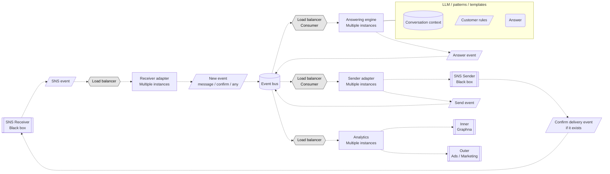

# Architecture

Converted from [Architecture.pdf](Architecture.pdf). Dashed arrows show event connections. The solid connector associates the answering engine with its resource enclosure. Stacked workers in the source are represented as multiple instances.

## Source annotations

| Component | Annotation |
| --- | --- |
| All four load balancers | "if messages count influent to system timeout"; "For example 1M". |
| Receiver adapter | `Idempotency key: recipient_id` and `timestamp` appear as separate highlighted lines. |
| Receiver adapter | Matcher, filter, converter. |
| Event bus | Technology labels: `kafka`, `postgres`, `rabbit`, `MtM dbs`. |
| Event bus | If message volume affects the system timeout, add parallel data handling. The source gives "1M" as an example. |
| Event bus | A separate downward arrow is labeled "event flow". It indicates direction, without connecting additional components. |

`MtM dbs` and `Graphna` are preserved as written in the source. The source does not specify a unit for "1M" or whether `timestamp` is part of the idempotency key. The answering enclosure contains no connections between its three internal elements.
