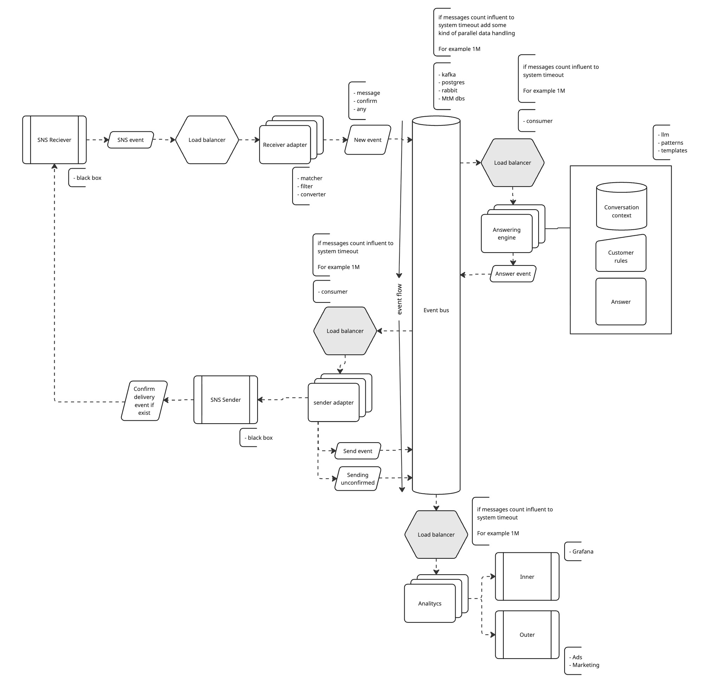

# blotato_take_home

## Me:

- Shocked that any developers use vim
- Absolutely sure that Claude and Codex are smarter & faster than i
- Im still wondering what made me start thinking about making this monadic
- I couldnt think of anything funny to say here - thats true
- In js everything is an object if you are brave enought

## Project:

- **!Important** - This repo is a single deployable app to keep the take-home simple. A real project should split into microservices (ingestion, automation engine, outbound sender, analytics) so each can scale and fail on its own

## Architecture:

Details: [ARCHITECTURE.md](ARCHITECTURE.md)

## Development workflow

1. Define the task
2. One LLM writes the code
3. A second LLM reviews it
4. A human reviews the result

For the next task, the LLMs swap implementation and review roles

## Log:
Who did what: me or an LLM

| # | Work | By |
| --- | --- | --- |
| 1 | Architecture design | Me |
| 2 | Stack choice | Me |
| 3 | RULES and the documentation LLMs need | Me |
| 4 | App setup following the chosen architecture and stack | LLM |
| 5 | Clean architecture implementation | LLM |
| 6 | Examples of the coding approach | Me |
| 7 | Hand-written examples in the codebase | Me |
| 8 | Fixes from review comments and documentation clarifications | LLM |
| 9 | Business logic, built iteratively in about 10 steps | Both |
| 10 | Architecture documentation review and update | Me |

Lines of code written by hand: 10
