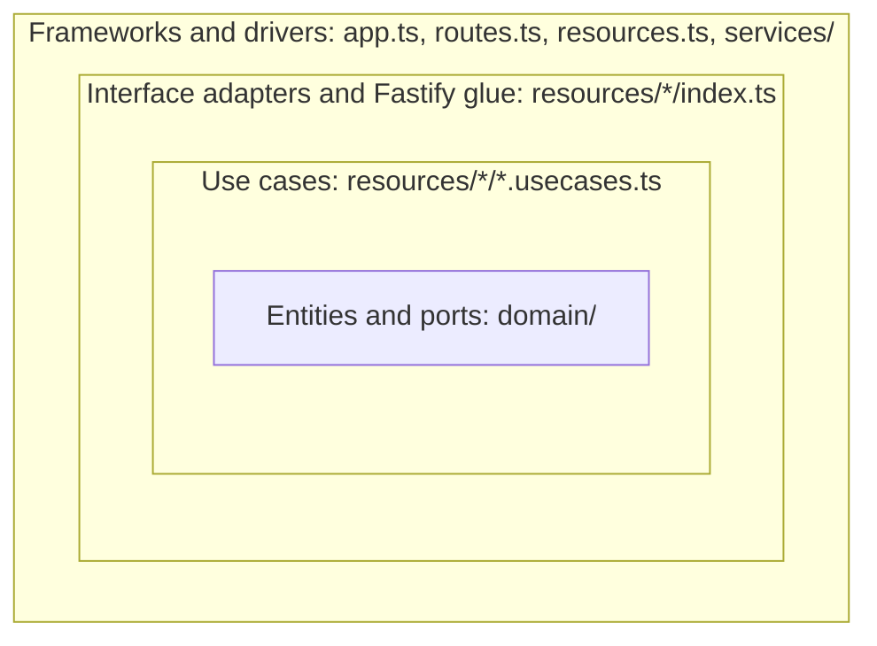

# Rules

Coding rules for this repo.

## **Clean architecture**

Code is split into four layers. Domain and use-case dependencies point inward; imports within the same layer are allowed. Resource `index.ts` files are framework glue and may import Fastify and access the DI container.

| Layer | Location | Contains | May import |
| --- | --- | --- | --- |
| Entities and ports | `src/domain/` | Domain types (events, rules, runs), pure business rules, and narrow port interfaces required by current use cases | Only `src/domain/` |
| Use cases | `src/resources/<name>/<name>.usecases.ts` | Application logic as functions; external dependencies are passed explicitly as ports | Entities, ports, other use cases, and application helpers in the same layer |
| Interface adapters | `src/resources/<name>/index.ts`, `src/resources/<name>/adapters/` | Fastify plugins: resolve dependencies, manage subscriptions, validate and normalize external payloads, call use cases, log and handle errors | Fastify, Awilix, container, use cases, entities, ports, and other adapters |
| Frameworks and drivers | `src/app.ts`, `src/routes.ts`, `src/resources.ts`, `src/services/` | Fastify, Awilix, event bus, outer receiver and sender, future database; implementations of the ports | Anything |

- Domain and use-case files never import Fastify, Awilix, interface adapters, or `src/services/*`, including through `import type`. Shared application helpers follow the same restrictions as use cases.
- Use cases may share application functions and helpers. Do not move application orchestration into `src/domain/` merely to make it reusable.
- Use cases depend on narrow ports, not concrete services. Define ports for capabilities actually needed: for example, an `EventPublisher` exposes publication without subscription management. `src/services/` implements the ports; `src/services/di_container.ts` is the only place that binds them.
- Data passed from adapters to use cases uses domain types. Adapters validate and normalize external payloads (for example an SNS event). Business matching, filtering, and decisions belong in use cases or pure domain rules.
- Adapters stay thin: resolve dependencies, manage subscriptions, call an application entry point, and handle errors. They do not contain business logic.
- Handlers log unhandled failures once and propagate them. Pass a logging port into a use case only when it needs additional logging; do not require unused logger arguments.
- Entities and use cases must be testable without starting the server or the container.

## **Commits**

- Commit messages use `<CONTEXT>[, <CONTEXT>]: short description` with at most three contexts in one commit. Split larger changes into different commits per finished logical blocks
